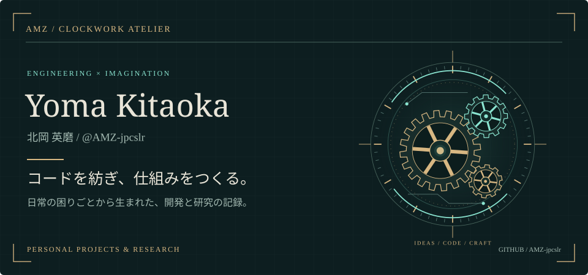

<!-- Generated by scripts/generate.mjs from profile.json. -->

<a href="https://portfolio-amz-jpcslr.vercel.app/"><picture>
<source media="(prefers-reduced-motion: reduce) and (max-width: 540px)" srcset="assets/clockwork/hero-static-mobile.svg">
<source media="(prefers-reduced-motion: reduce)" srcset="assets/clockwork/hero-static.svg">
<source media="(max-width: 540px)" srcset="assets/clockwork/hero-mobile.svg">

</picture></a>

<a href="https://portfolio-amz-jpcslr.vercel.app/">Portfolio ↗</a>　·　<a href="https://portfolio-amz-jpcslr.vercel.app/about/">About me ↗</a>　·　<a href="https://github.com/AMZ-jpcslr?tab=repositories">Repositories ↗</a>

<h2>01 / 自己紹介</h2>

<b>北岡 英磨</b>　/　立命館大学 情報理工学部

普段使う駅で次の電車を知りたいときや、声を出せずにDiscordの会話に入りづらいとき。そんな場面からアプリやBotをつくっています。使う人に試してもらい、最初に見たい情報や迷った操作を聞いて、次の改善を決めています。

<code>画面設計</code> <code>ボット開発</code> <code>AI研究</code>

<h2>02 / アプリ・Bot</h2>

作品名からソースコードへ移動できます。

<table>
<tr>
<td>
01 / 交通アプリ 
<strong><a href="https://github.com/AMZ-jpcslr/train_time">まにあう</a></strong> 
駅まで歩く時間と時刻表から、今出たらどの電車に乗れそうかを調べる。 
<a href="https://github.com/AMZ-jpcslr/train_time">コード ↗</a>　·　<a href="https://portfolio-amz-jpcslr.vercel.app/projects/mania/">制作の背景 ↗</a>
</td>
</tr>
<tr>
<td>
02 / 就活カレンダー 
<strong><a href="https://github.com/AMZ-jpcslr/Syukatu-Note">しゅうかつ手帳</a></strong> 
応募の締切と選考予定をひとつのカレンダーで見渡す。 
<a href="https://github.com/AMZ-jpcslr/Syukatu-Note">コード ↗</a>　·　<a href="https://portfolio-amz-jpcslr.vercel.app/projects/career/">制作の背景 ↗</a>
</td>
</tr>
<tr>
<td>
03 / 配信ツール 
<strong><a href="https://github.com/AMZ-jpcslr/Streaming-Screen">Streaming Screen</a></strong> 
文字・画像・時計を配置して、保存したレイアウトをOBSの配信画面に反映する。 
<a href="https://github.com/AMZ-jpcslr/Streaming-Screen">コード ↗</a>　·　<a href="https://portfolio-amz-jpcslr.vercel.app/projects/stream/">制作の背景 ↗</a>
</td>
</tr>
<tr>
<td>
04 / 読み上げBot 
<strong><a href="https://github.com/AMZ-jpcslr/Yomiage_Discord_Bot">Yomiage Bot</a></strong> 
声を出せないときも、テキストを読み上げてDiscordの通話に参加できる。 
<a href="https://github.com/AMZ-jpcslr/Yomiage_Discord_Bot">コード ↗</a>　·　<a href="https://portfolio-amz-jpcslr.vercel.app/projects/voice/">制作の背景 ↗</a>
</td>
</tr>
<tr>
<td>
05 / 防災通知Bot 
<strong><a href="https://github.com/AMZ-jpcslr/Shindo_Discord_Bot">Shindo Bot</a></strong> 
普段開いているDiscordで、地震や地域の気象情報を受け取る。 
<a href="https://github.com/AMZ-jpcslr/Shindo_Discord_Bot">コード ↗</a>　·　<a href="https://portfolio-amz-jpcslr.vercel.app/projects/weather/">制作の背景 ↗</a>
</td>
</tr>
</table>

<h2>03 / 研究・検証</h2>

AIの行動判断、通信の可視化、ロボットサッカーの位置評価に取り組んでいます。

<table>
<tr>
<td>
06 / 個人研究 
<strong><a href="https://github.com/AMZ-jpcslr/Artificial-Moral-Architecture">Artificial Moral Architecture</a></strong> 
AIが行動する前に、その選択が誰にどんな影響を与えるかを評価する研究。 
<a href="https://github.com/AMZ-jpcslr/Artificial-Moral-Architecture">コード ↗</a>　·　<a href="https://portfolio-amz-jpcslr.vercel.app/projects/moral/">制作の背景 ↗</a>
</td>
</tr>
<tr>
<td>
07 / 通信検査ツール 
<strong><a href="https://github.com/AMZ-jpcslr/ssl-inspection-prodxy">Inspection Proxy</a></strong> 
ブラウザーの通信を記録し、どんな内容がやり取りされたかをログで確かめる。 
<a href="https://github.com/AMZ-jpcslr/ssl-inspection-prodxy">コード ↗</a>　·　<a href="https://portfolio-amz-jpcslr.vercel.app/projects/proxy/">制作の背景 ↗</a>
</td>
</tr>
<tr>
<td>
08 / 2Dシミュレーション 
<strong><a href="https://github.com/AMZ-jpcslr/SSL-DEMO">SSL Robot AI</a></strong> 
ロボットの位置を評価し、移動先やパスの選び方をフィールド上で比較する。 
<a href="https://github.com/AMZ-jpcslr/SSL-DEMO">コード ↗</a>　·　<a href="https://portfolio-amz-jpcslr.vercel.app/projects/soccer/">制作の背景 ↗</a>
</td>
</tr>
</table>

AMZ / CLOCKWORK ATELIER <a href="https://portfolio-amz-jpcslr.vercel.app/">ポートフォリオを見る ↗</a>

