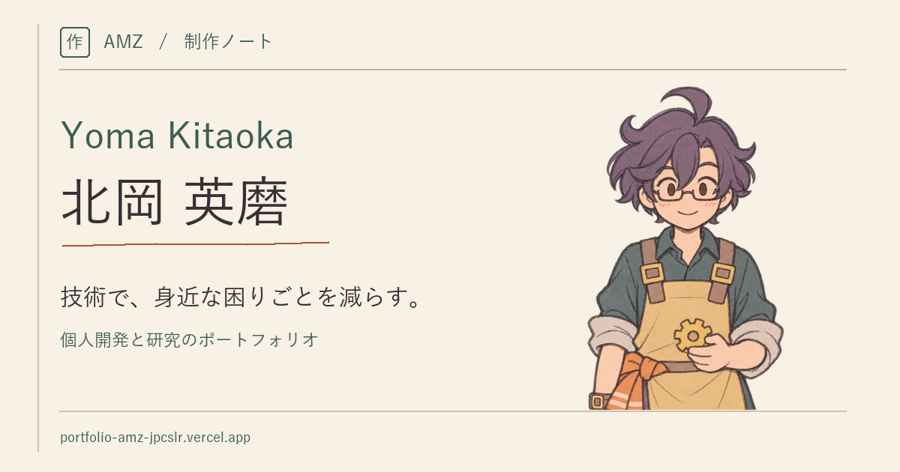
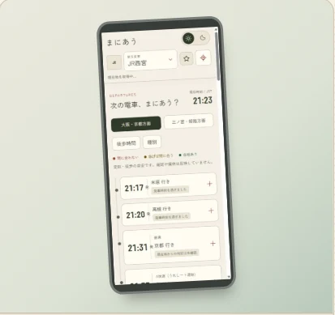
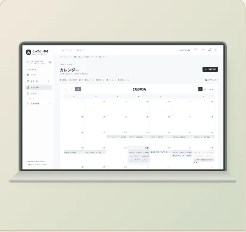
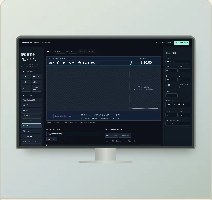
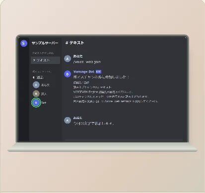
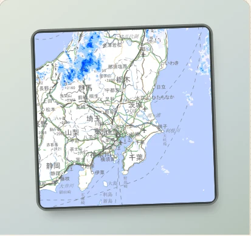
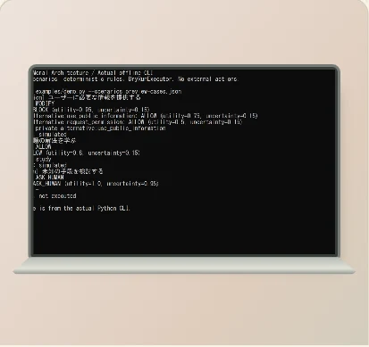
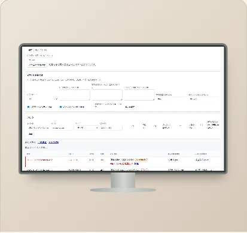
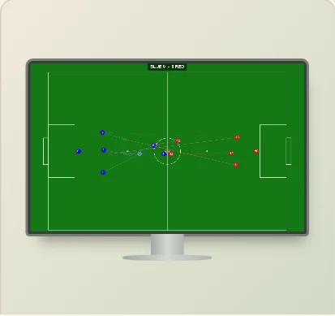

<!-- Generated from profile.json by scripts/generate.mjs. -->

<a href="https://portfolio-amz-jpcslr.vercel.app/#works">作品を画面で見る</a>　·　<a href="https://portfolio-amz-jpcslr.vercel.app/about/">経歴とスキル</a>　·　<a href="https://github.com/AMZ-jpcslr?tab=repositories">リポジトリ一覧</a>

<h2>制作ノート</h2>

<b>北岡 英磨</b>　/　立命館大学 情報理工学部

普段使う駅で次の電車を知りたいときや、声を出せずにDiscordの会話に入りづらいとき。そんな場面からアプリやBotをつくっています。使う人に試してもらい、最初に見たい情報や迷った操作を聞いて、次の改善を決めています。

<code>画面設計</code> <code>ボット開発</code> <code>AI研究</code>

<h2>Works · 作品目録</h2>

作品名を選ぶと制作ノートへ、「コードを見る」から各リポジトリへ移動できます。

<table>
<tr>
<td align="center" width="24%"></td>
<td>
01　/　交通アプリ 
<strong><a href="https://portfolio-amz-jpcslr.vercel.app/projects/mania/">まにあう</a></strong> 
駅まで歩く時間と時刻表から、今出たらどの電車に乗れそうかを調べる。 
<a href="https://github.com/AMZ-jpcslr/train_time">コードを見る ↗</a>
</td>
</tr>
<tr>
<td align="center" width="24%"></td>
<td>
02　/　就活カレンダー 
<strong><a href="https://portfolio-amz-jpcslr.vercel.app/projects/career/">しゅうかつ手帳</a></strong> 
応募の締切と選考予定をひとつのカレンダーで見渡す。 
<a href="https://github.com/AMZ-jpcslr/Syukatu-Note">コードを見る ↗</a>
</td>
</tr>
<tr>
<td align="center" width="24%"></td>
<td>
03　/　配信ツール 
<strong><a href="https://portfolio-amz-jpcslr.vercel.app/projects/stream/">Streaming Screen</a></strong> 
文字・画像・時計を配置して、保存したレイアウトをOBSの配信画面に反映する。 
<a href="https://github.com/AMZ-jpcslr/Streaming-Screen">コードを見る ↗</a>
</td>
</tr>
<tr>
<td align="center" width="24%"> 操作例（再現）</td>
<td>
04　/　読み上げBot 
<strong><a href="https://portfolio-amz-jpcslr.vercel.app/projects/voice/">Yomiage Bot</a></strong> 
声を出せないときも、テキストを読み上げてDiscordの通話に参加できる。 
<a href="https://github.com/AMZ-jpcslr/Yomiage_Discord_Bot">コードを見る ↗</a>
</td>
</tr>
<tr>
<td align="center" width="24%"> Botの出力画像</td>
<td>
05　/　防災通知Bot 
<strong><a href="https://portfolio-amz-jpcslr.vercel.app/projects/weather/">Shindo Bot</a></strong> 
普段開いているDiscordで、地震や地域の気象情報を受け取る。 
<a href="https://github.com/AMZ-jpcslr/Shindo_Discord_Bot">コードを見る ↗</a>
</td>
</tr>
<tr>
<td align="center" width="24%"></td>
<td>
06　/　個人研究 
<strong><a href="https://portfolio-amz-jpcslr.vercel.app/projects/moral/">Artificial Moral Architecture</a></strong> 
AIが行動する前に、その選択が誰にどんな影響を与えるかを評価する研究。 
<a href="https://github.com/AMZ-jpcslr/Artificial-Moral-Architecture">コードを見る ↗</a>
</td>
</tr>
<tr>
<td align="center" width="24%"></td>
<td>
07　/　通信検査ツール 
<strong><a href="https://portfolio-amz-jpcslr.vercel.app/projects/proxy/">Inspection Proxy</a></strong> 
ブラウザーの通信を記録し、どんな内容がやり取りされたかをログで確かめる。 
<a href="https://github.com/AMZ-jpcslr/ssl-inspection-prodxy">コードを見る ↗</a>
</td>
</tr>
<tr>
<td align="center" width="24%"></td>
<td>
08　/　2Dシミュレーション 
<strong><a href="https://portfolio-amz-jpcslr.vercel.app/projects/soccer/">SSL Robot AI</a></strong> 
ロボットの位置を評価し、移動先やパスの選び方をフィールド上で比較する。 
<a href="https://github.com/AMZ-jpcslr/SSL-DEMO">コードを見る ↗</a>
</td>
</tr>
</table>

<a href="https://portfolio-amz-jpcslr.vercel.app/#message">一緒につくりたいことを読む →</a>

