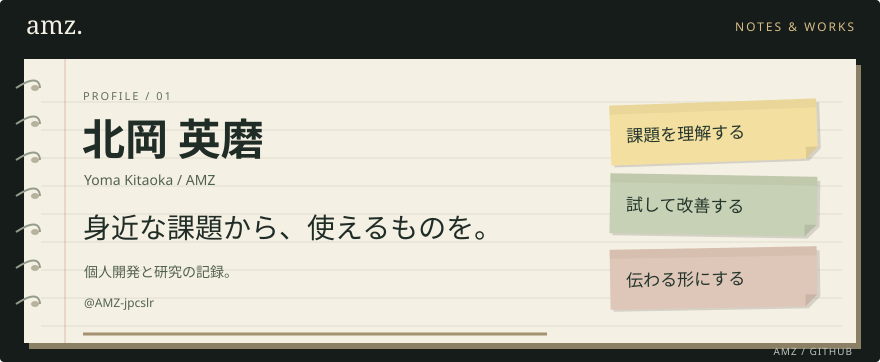
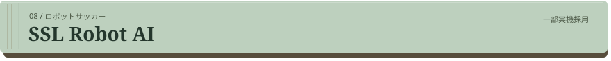

<!-- Generated by scripts/generate.mjs. Edit profile.json, then run npm run build. -->

<picture>
  <source media="(prefers-reduced-motion: no-preference) and (max-width: 540px)" srcset="assets/notebook-motion-mobile.svg">
  <source media="(prefers-reduced-motion: no-preference)" srcset="assets/notebook-motion.svg">
  <source media="(max-width: 540px)" srcset="assets/notebook-mobile.svg">
  
</picture>

<a href="https://portfolio-amz-jpcslr.vercel.app/"><b>ポートフォリオ ↗</b></a> &nbsp; · &nbsp; <a href="https://github.com/AMZ-jpcslr?tab=repositories">リポジトリ一覧 ↗</a>

<h2>自己紹介</h2>

PdMを目指し、個人開発と個人研究に取り組んでいます。身近な不便や友人との会話をきっかけに、WebアプリやDiscord Botをつくり、使う人の声を聞きながら改善しています。AIの行動前の影響評価や、ロボットサッカーの位置評価にも取り組んできました。

<h2>使っている技術</h2>

<h2>つくったもの</h2>

つくった理由や工夫は、ポートフォリオの各作品ページにまとめています。

<h3><a href="https://portfolio-amz-jpcslr.vercel.app/projects/mania/"><picture>
  <source media="(max-width: 540px)" srcset="assets/book-mania-mobile.svg">
  
</picture></a></h3>

いつもの駅の時刻表と、駅まで歩く時間をもとに、次に乗れる電車の目安を表示するアプリです。

<code>React</code> <code>TypeScript</code> <code>Vite</code> 
<a href="https://portfolio-amz-jpcslr.vercel.app/projects/mania/">詳しく読む ↗</a> &nbsp; · &nbsp; <a href="https://github.com/AMZ-jpcslr/train_time">コードを見る ↗</a>

<h3><a href="https://portfolio-amz-jpcslr.vercel.app/projects/career/"><picture>
  <source media="(max-width: 540px)" srcset="assets/book-career-mobile.svg">
  
</picture></a></h3>

公開募集を自分用に引用し、応募・締切・選考の予定をまとめて管理するWebアプリです。友人に使ってもらいながら改善しています。

<code>Next.js</code> <code>TypeScript</code> <code>Supabase</code> 
<a href="https://portfolio-amz-jpcslr.vercel.app/projects/career/">詳しく読む ↗</a> &nbsp; · &nbsp; <a href="https://github.com/AMZ-jpcslr/Syukatu-Note">コードを見る ↗</a>

<h3><a href="https://portfolio-amz-jpcslr.vercel.app/projects/stream/"><picture>
  <source media="(max-width: 540px)" srcset="assets/book-stream-mobile.svg">
  
</picture></a></h3>

テキスト・画像・時計を配置し、保存した画面をOBSへ出力できるエディターです。配信者からの依頼で制作しました。

<code>JavaScript</code> <code>Node.js</code> <code>OBS</code> 
<a href="https://portfolio-amz-jpcslr.vercel.app/projects/stream/">詳しく読む ↗</a> &nbsp; · &nbsp; <a href="https://github.com/AMZ-jpcslr/Streaming-Screen">コードを見る ↗</a>

<h3><a href="https://portfolio-amz-jpcslr.vercel.app/projects/voice/"><picture>
  <source media="(max-width: 540px)" srcset="assets/book-voice-mobile.svg">
  
</picture></a></h3>

声を出せないときも会話に参加できるように、Discordのテキストを読み上げ、相手に合わせて翻訳するBotをつくりました。

<code>TypeScript</code> <code>VOICEVOX</code> <code>DeepL</code> 
<a href="https://portfolio-amz-jpcslr.vercel.app/projects/voice/">詳しく読む ↗</a> &nbsp; · &nbsp; <a href="https://github.com/AMZ-jpcslr/Yomiage_Discord_Bot">コードを見る ↗</a>

<h3><a href="https://portfolio-amz-jpcslr.vercel.app/projects/weather/"><picture>
  <source media="(max-width: 540px)" srcset="assets/book-weather-mobile.svg">
  
</picture></a></h3>

普段開いているDiscordで地震や気象の情報に気づけるように、通知を届けるBotをつくりました。

<code>TypeScript</code> <code>WebSocket</code> <code>Node.js</code> 
<a href="https://portfolio-amz-jpcslr.vercel.app/projects/weather/">詳しく読む ↗</a> &nbsp; · &nbsp; <a href="https://github.com/AMZ-jpcslr/Shindo_Discord_Bot">コードを見る ↗</a>

<h3><a href="https://portfolio-amz-jpcslr.vercel.app/projects/moral/"><picture>
  <source media="(max-width: 540px)" srcset="assets/book-moral-mobile.svg">
  
</picture></a></h3>

行動前の予測と、影響を受ける当事者の評価を、AIの行動選択につなぐ仕組みを研究しています。固定ルールと合成シナリオで検証しています。

<code>Python</code> <code>AI</code> 
<a href="https://portfolio-amz-jpcslr.vercel.app/projects/moral/">詳しく読む ↗</a> &nbsp; · &nbsp; <a href="https://github.com/AMZ-jpcslr/Artificial-Moral-Architecture">コードを見る ↗</a>

<h3><a href="https://portfolio-amz-jpcslr.vercel.app/projects/proxy/"><picture>
  <source media="(max-width: 540px)" srcset="assets/book-proxy-mobile.svg">
  
</picture></a></h3>

通信の内容と検出結果を可視化し、何がやり取りされているかを確認するためのプロキシです。

<code>HTTP</code> <code>HTTPS</code> <code>Proxy</code> 
<a href="https://portfolio-amz-jpcslr.vercel.app/projects/proxy/">詳しく読む ↗</a> &nbsp; · &nbsp; <a href="https://github.com/AMZ-jpcslr/ssl-inspection-prodxy">コードを見る ↗</a>

<h3><a href="https://portfolio-amz-jpcslr.vercel.app/projects/soccer/"><picture>
  <source media="(max-width: 540px)" srcset="assets/book-soccer-mobile.svg">
  
</picture></a></h3>

移動先やパス相手を考えるための位置評価シミュレーターです。位置評価の仕組みを、チームへの導入用プロトタイプとして活用してもらいました。

<code>Java</code> <code>Simulation</code> 
<a href="https://portfolio-amz-jpcslr.vercel.app/projects/soccer/">詳しく読む ↗</a> &nbsp; · &nbsp; <a href="https://github.com/AMZ-jpcslr/SSL-DEMO">コードを見る ↗</a>

<h2>大切にしていること</h2>
<ul>
<li><b>課題を理解する。</b> 誰が、どんな場面で使うのかを考えます。</li>
<li><b>試して改善する。</b> 小さく形にして、使う人の声を次の改善につなげます。</li>
<li><b>伝わる形にする。</b> 必要な情報を見つけやすくし、迷わず判断できるようにします。</li>
</ul>

つくったものと、その過程を少しずつ記録しています。 <a href="https://portfolio-amz-jpcslr.vercel.app/">AMZ — Notes & Works ↗</a>

