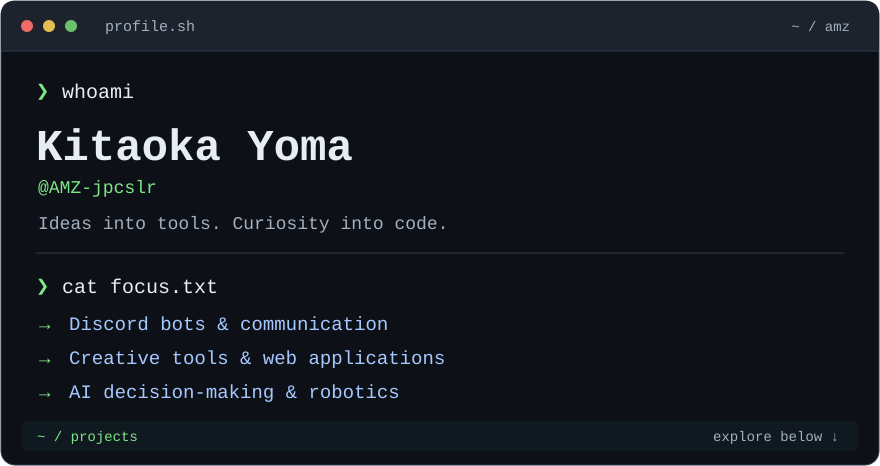
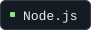

<!-- Generated by scripts/generate.mjs. Edit profile.json, then run npm run build. -->

<picture>
  <source media="(max-width: 540px) and (prefers-color-scheme: dark)" srcset="assets/terminal-mobile-dark.svg">
  <source media="(max-width: 540px) and (prefers-color-scheme: light)" srcset="assets/terminal-mobile-light.svg">
  <source media="(prefers-color-scheme: dark)" srcset="assets/terminal-dark.svg">
  <source media="(prefers-color-scheme: light)" srcset="assets/terminal-light.svg">
  
</picture>

<a href="https://portfolio-amz-jpcslr.vercel.app"><b>Portfolio ↗</b></a> &nbsp;·&nbsp; <a href="https://github.com/AMZ-jpcslr?tab=repositories">All repositories ↗</a>

<h2><code>~/about</code></h2>

Discord Botや配信ツールなど、身近な課題を解決するソフトウェアを開発しています。AIの行動判断やロボットサッカーにも取り組んでいます。

<h2><code>~/toolbox</code></h2>

<picture>
  <source media="(prefers-color-scheme: dark)" srcset="assets/skill-1-dark.svg">
  <source media="(prefers-color-scheme: light)" srcset="assets/skill-1-light.svg">
  
</picture>
<picture>
  <source media="(prefers-color-scheme: dark)" srcset="assets/skill-2-dark.svg">
  <source media="(prefers-color-scheme: light)" srcset="assets/skill-2-light.svg">
  
</picture>
<picture>
  <source media="(prefers-color-scheme: dark)" srcset="assets/skill-3-dark.svg">
  <source media="(prefers-color-scheme: light)" srcset="assets/skill-3-light.svg">
  
</picture>
<picture>
  <source media="(prefers-color-scheme: dark)" srcset="assets/skill-4-dark.svg">
  <source media="(prefers-color-scheme: light)" srcset="assets/skill-4-light.svg">
  
</picture>
<picture>
  <source media="(prefers-color-scheme: dark)" srcset="assets/skill-5-dark.svg">
  <source media="(prefers-color-scheme: light)" srcset="assets/skill-5-light.svg">
  
</picture>
<picture>
  <source media="(prefers-color-scheme: dark)" srcset="assets/skill-6-dark.svg">
  <source media="(prefers-color-scheme: light)" srcset="assets/skill-6-light.svg">
  
</picture>

<h2><code>~/projects</code></h2>
<table>
<tr>
<td width="50%" valign="top">

01 / COMMUNICATION

<h3><a href="https://github.com/AMZ-jpcslr/Yomiage_Discord_Bot">Yomiage Bot ↗</a></h3>

テキストを声に、メンションを相手の言語に。VOICEVOXとDeepLを使った読み上げ・翻訳Bot。

<code>TypeScript</code> <code>VOICEVOX</code> <code>DeepL</code>

</td>
<td width="50%" valign="top">

02 / DISASTER INFORMATION

<h3><a href="https://github.com/AMZ-jpcslr/Shindo_Discord_Bot">Shindo Bot ↗</a></h3>

地震・津波・地域別の気象情報を、いつものDiscordへ。雨雲レーダーの表示にも対応。

<code>TypeScript</code> <code>WebSocket</code> <code>Node.js</code>

</td>
</tr>
<tr>
<td width="50%" valign="top">

03 / CREATOR TOOLS

<h3><a href="https://github.com/AMZ-jpcslr/Streaming-Screen">Streaming Screen ↗</a></h3>

テキスト・画像・時計を自由に配置。OBSの配信画面を組み立てるレイアウトエディター。

<code>JavaScript</code> <code>Node.js</code> <code>OBS</code>

</td>
<td width="50%" valign="top">

04 / AI / RESEARCH

<h3><a href="https://github.com/AMZ-jpcslr/Artificial-Moral-Architecture">Artificial Moral Architecture ↗</a></h3>

行動前の結果予測と、複数の当事者への影響評価を組み込むAIの行動判断基盤。個人研究として開発中。

<code>Python</code> <code>AI</code> <code>Research</code>

</td>
</tr>
</table>

More projects

<ul>
<li><a href="https://github.com/AMZ-jpcslr/ssl-inspection-prodxy">Web Browsing Inspection Proxy</a> — HTTP / HTTPS通信を可視化する、学習・検証用プロキシ。</li>
<li><a href="https://github.com/AMZ-jpcslr/SSL-DEMO">SSL Robot AI</a> — Javaでつくる、ロボットサッカーの2Dシミュレーター。</li>
</ul>

<code>amz@github:~$</code> Thanks for stopping by.

